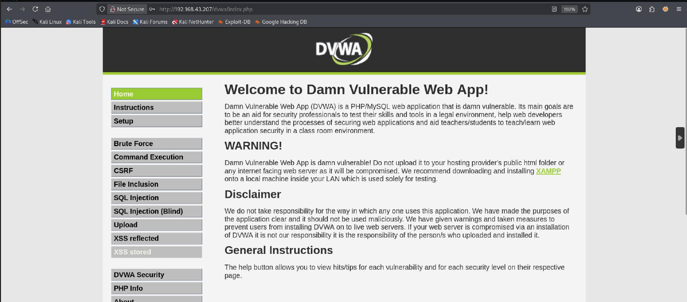
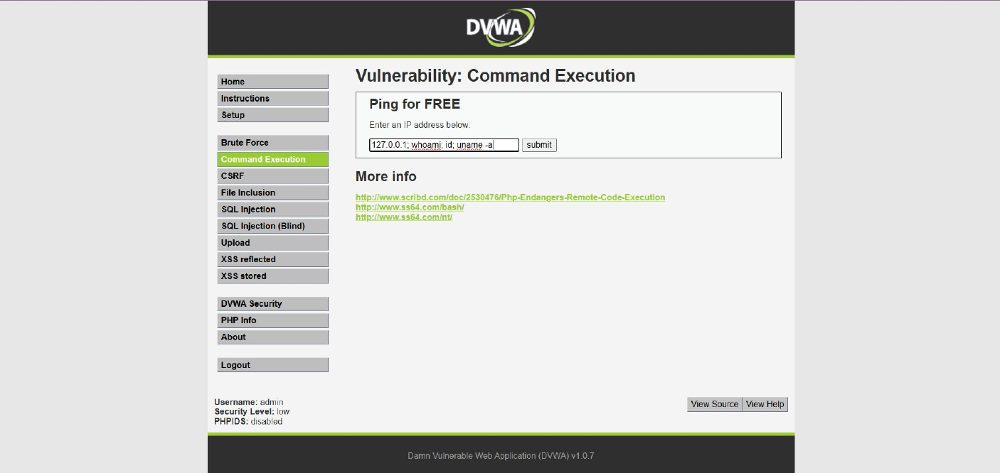
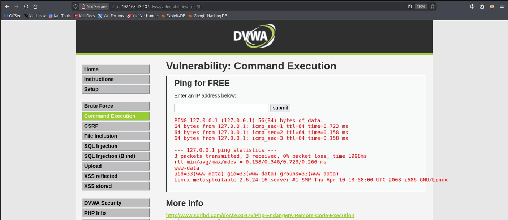
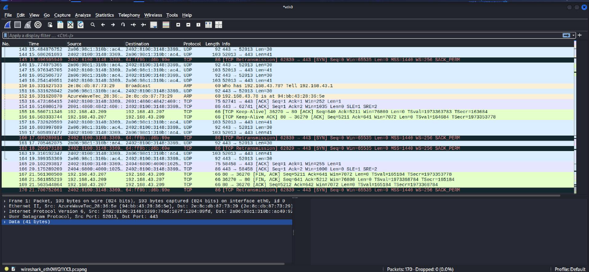
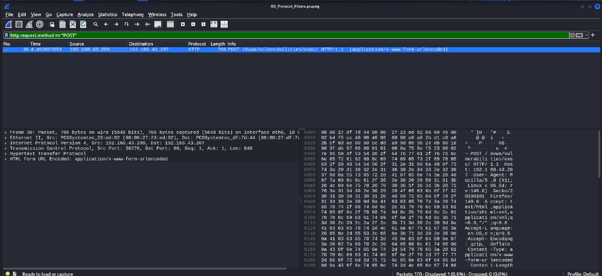
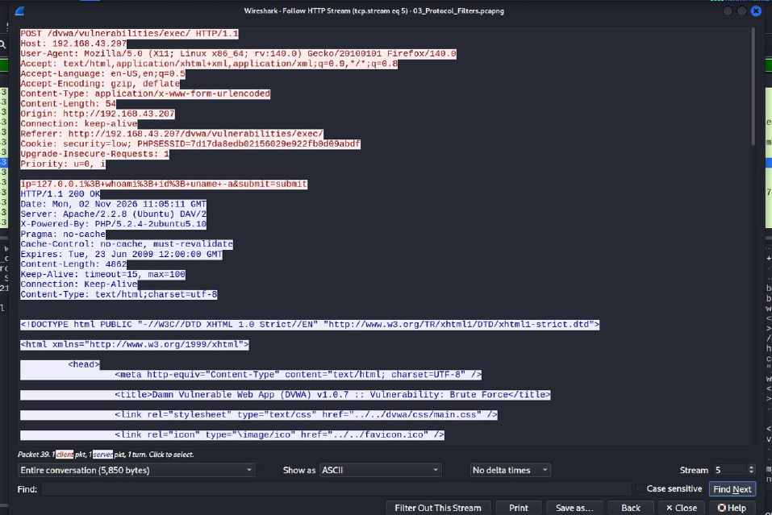
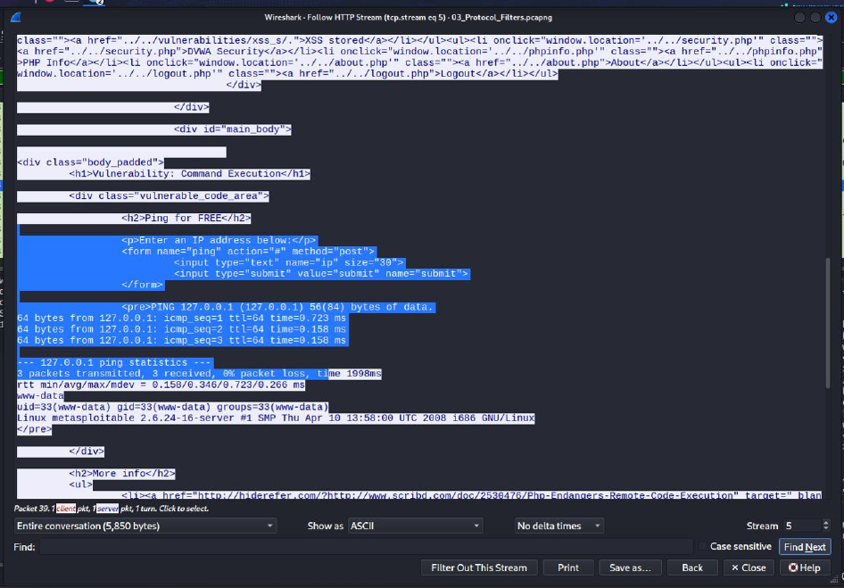
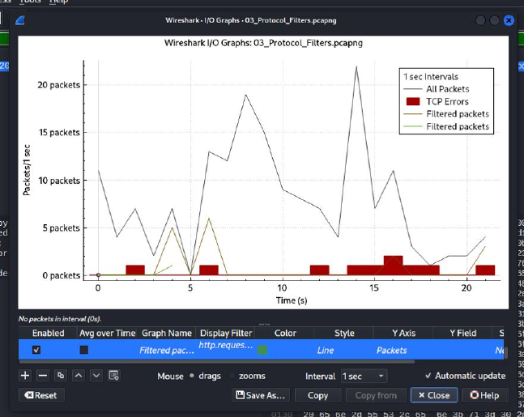

# 🦈 Wireshark: Packet Sniffer and Network Protocol Analysis


> **Cybersecurity Internship Project** | Project ID: `PTID-CSPP-OCT-26-666`
> **Presented by:** Mahesh Ade | **Organization:** Skillogic

Live packet capture and protocol analysis in a private lab, following the steps of a forensic investigator: **capture → filter → follow the conversation → find the risk → record the evidence**.

---

## 📑 Table of Contents

1. [Introduction](#-introduction)
2. [Objectives](#-objectives)
3. [Use Case](#-use-case)
4. [Lab Setup](#-lab-setup)
5. [Methodology](#-methodology)
6. [Capture Files and Evidence](#-capture-files-and-evidence)
7. [Practical Analysis](#-practical-analysis)
8. [Security Findings](#-security-findings)
9. [Recommendations](#-recommendations)
10. [Conclusion](#-conclusion)
11. [Limitations and Future Work](#-limitations-and-future-work)
12. [Appendix A: Display Filters](#appendix-a-display-filters-used)
13. [Appendix B: Evidence Integrity](#appendix-b-evidence-integrity)
14. [Repository Structure](#-repository-structure)
15. [How to Reproduce](#-how-to-reproduce)
16. [Disclaimer](#-disclaimer)

---

## 📖 Introduction

Computer networks carry a large amount of data every second. A **packet sniffer** captures this data so it can be studied. **Wireshark** is a free and open-source network protocol analyzer. It shows each packet in a readable form and explains the protocol fields inside it.

| Role | Description |
|------|-------------|
| **Packet sniffer** | Captures live traffic from a network interface |
| **Protocol analyzer** | Decodes protocols such as TCP, HTTP, UDP, DNS and ARP |
| **Forensic tool** | Saves traffic in `.pcapng` files for later investigation |

## 🎯 Objectives

- Capture live network traffic with Wireshark on a Kali Linux machine.
- Study how common protocols work: **TCP, HTTP, UDP, ARP and DNS**.
- Use display filters, Follow Stream and graphs to find the important packets.
- Find security risks in the traffic and record the evidence like a forensic auditor.
- Suggest practical ways to protect the network.

## 🔍 Use Case

**Security Analysis and Forensic Auditing**: Wireshark is used as an investigation tool to **detect** suspicious or risky activity, **investigate** it packet by packet, and **report** the evidence. Saved `.pcapng` files let another person open the same evidence later and verify the results.

## 🧪 Lab Setup

| Component | Details |
|-----------|---------|
| Analyst machine | Kali Linux, IP `192.168.43.209` |
| Target machine | Metasploitable server, IP `192.168.43.207` |
| Test web application | DVWA v1.0.7 (security level: low) |
| Capture tool | Wireshark 4.6.6 on interface `eth0` |
| Browser | Firefox on Kali Linux |
| Evidence format | Capture files in `.pcapng` format |

```
 ┌────────────────────┐        HTTP / test traffic        ┌──────────────────────────┐
 │  Kali Linux        │ ───────────────────────────────▶ │  Metasploitable + DVWA    │
 │  192.168.43.209    │                                   │  192.168.43.207           │
 │  Wireshark (eth0)  │ ◀─────────────────────────────── │  Apache 2.2.8 / PHP 5.2.4 │
 └────────────────────┘                                   └──────────────────────────┘
```

> All testing was done inside a **private lab network** on systems built for security practice. No real or third-party system was tested.

## 🛠 Methodology

1. **Setup:** Install Wireshark and choose the `eth0` interface.
2. **Capture:** Start a live capture on the network.
3. **Generate test traffic:** Browse DVWA and send a test request to the target.
4. **Analyze:** Apply display filters, follow the HTTP stream, read the I/O graph, and study ARP, DNS and TCP SYN packets.
5. **Report:** Record the findings, save the capture files and note their SHA-256 hashes.

## 📦 Capture Files and Evidence

| File | Packets | Duration | What it holds |
|------|:------:|:--------:|---------------|
| `01_Interface.pcapng` | 587 | ~85 s | Wider capture of all traffic on `eth0`, including lab test and background traffic |
| `02_Live_Capture.pcapng` | 170 | ~22 s | Focused capture of the DVWA test and surrounding traffic |
| `03_Protocol_Filters.pcapng` | 170 | ~22 s | Same capture as file 02, used for filters, Follow Stream and I/O Graph |

**Protocol mix**

| Protocol | File 01 (587 pkts) | File 02 (170 pkts) |
|----------|:-----------------:|:------------------:|
| TCP (incl. HTTP) | 453 | 58 |
| UDP | 57 | 94 |
| DNS | 36 | 8 |
| ICMP / ICMPv6 | 31 | 4 |
| ARP | 10 | 6 |

In file 02, only **16 of 170 packets (~9%)** were lab traffic between `192.168.43.209` and `192.168.43.207`. The rest was background traffic, which is why filters are needed to find the evidence that matters.

## 🔬 Practical Analysis

### 7.1 Test traffic: DVWA Command Execution

DVWA's *Command Execution* page pings an IP address. A test input with extra harmless commands was typed after the IP:

```
127.0.0.1; whoami; id; uname -a
```

| DVWA opened on the target | Test input in "Ping for FREE" |
|:---:|:---:|
|  |  |

The server returned the ping result **followed by the output of the extra commands**: the web server user (`www-data`), its user ID (`uid=33`) and Linux system details. The page passed our extra text to the system and ran it. This weakness is called **command injection**.



### 7.2 Live capture overview

Wireshark captured live traffic on `eth0`. File 02 shows **170 packets with none dropped**. Red/black rows point to TCP problems such as retransmissions; green rows show the HTTP connection between the two lab machines.



### 7.3 Display filter: finding the HTTP POST request

```
http.request.method == "POST"
```

This reduced 170 packets to **one** (frame 30), sent from `192.168.43.209` to `192.168.43.207` on port 80 for `POST /dvwa/vulnerabilities/exec/`.

> A **capture filter** limits what is saved, while a **display filter** only hides packets that are already captured.



### 7.4 Follow HTTP Stream

Follow HTTP Stream rebuilds the whole conversation of TCP stream 5: one client packet and one server packet, **5,850 bytes** in total. Because the traffic is plain HTTP, the request headers, the session cookie (`PHPSESSID` and `security=low`), the injected input and the full reply can all be read.

| Client request (red) and server reply (blue) | Reply holds command output as readable text |
|:---:|:---:|
|  |  |

### 7.5 I/O Graph

The I/O Graph shows packets per second. The peak is about **22 packets in one second**, near the 14-second mark. Red bars show TCP errors (mostly retransmissions). The filtered line shows when the HTTP POST happened. Here, the spikes are normal lab and background traffic.



### 7.6 ARP analysis

Filter: `arp`. File 02 has 6 ARP packets (3 request/reply pairs); file 01 has 10.

| IP address | MAC address seen | Role |
|------------|------------------|------|
| 192.168.43.1 | `2e:8c:db:87:73:29` | Gateway |
| 192.168.43.209 | `08:00:27:23:ed:92` | Kali Linux analyst machine |
| 192.168.43.207 | `08:00:27:df:7d:44` | Metasploitable target |
| 192.168.43.78 | `94:bb:43:28:36:5e` | Another device on the network |

Every IP address was linked to only one MAC address in both captures, so **no ARP spoofing** was found.

### 7.7 DNS analysis

Filter: `dns`. File 02 has 8 DNS packets (4 queries, 4 responses), all for `dcg.microsoft.com` (a background service). File 01 has 36 DNS packets (18 responses) for names such as Google, YouTube, LinkedIn and Firefox services. DNS queries are sent in **plain text**, so anyone who can capture traffic can see which websites are being looked up.

### 7.8 TCP SYN packets and port scan check

Filter: `tcp.flags.syn == 1 && tcp.flags.ack == 0`

| Capture | SYN-only packets | Destinations (host:port) | Lab connection to 192.168.43.207:80 |
|---------|:---------------:|:------------------------:|:-----------------------------------:|
| File 01 | 92 | 14 | 1 (frame 52) |
| File 02 | 12 | 3 | 1 (frame 27) |

Most SYN packets were **retransmissions** to port 443 that got no answer. This is **not a port scan**, because many different ports on one host were not probed. This shows how the same filter can separate normal network trouble from an attack.

### 7.9 Conversations

| Address pair (file 02) | Packets | Bytes | Note |
|------------------------|:------:|:-----:|------|
| 192.168.43.78 (IPv6) and 2a06:98c1:310b::ac40:92d7 | 91 | 20,324 | UDP port 443 background traffic |
| 192.168.43.209 and 192.168.43.207 | 16 | 6,922 | Lab test: DVWA HTTP traffic |

## 🚨 Security Findings

| Finding | Evidence in the capture | Risk |
|---------|-------------------------|:----:|
| Data sent in plain text | Request and reply readable in Follow HTTP Stream | 🔴 High |
| Command injection input | `ip=127.0.0.1; whoami; id; uname -a` in the POST body | 🔴 High |
| Session cookie exposed | `PHPSESSID` and `security=low` visible in the request | 🔴 High |
| Server details leaked | Apache 2.2.8, PHP 5.2.4 and Linux 2.6.24 in the reply | 🟠 Medium |
| Plain-text DNS queries | Website names visible in DNS packets | 🟠 Medium |
| TCP retransmissions | Repeated SYN packets with no reply (not a port scan) | 🟡 Low |
| ARP spoofing | One MAC address per IP address in both captures | 🟢 None found |

*Ratings apply to this lab, which uses deliberately weak systems for practice.*

## ✅ Recommendations

- **Use HTTPS:** encrypt web traffic so packets cannot be read in transit.
- **Check user input:** validate and clean every input to stop command injection.
- **Protect cookies:** use the `Secure` and `HttpOnly` flags and short session times.
- **Hide server details:** keep software updated and remove version banners.
- **Encrypt DNS:** use DNS over HTTPS (DoH) or DNS over TLS (DoT).
- **Firewall and VPN:** limit who can reach the server and protect untrusted networks.
- **Monitor:** use an IDS such as Snort or Suricata and review captures regularly.

## 🏁 Conclusion

Wireshark captured and decoded real traffic from the lab network. Display filters, Follow Stream, the I/O Graph, and the ARP, DNS and SYN checks made it easy to find the key packets. The analysis showed that plain HTTP exposed the input, the session cookie and the server details, and that the web page ran injected commands. It also showed what normal traffic looks like, with no ARP spoofing and no port scan. **Encryption and input checks are essential protections.**

## ⚠️ Limitations and Future Work

- All traffic was captured in one small lab, so the results show the **method** rather than a full network.
- The analysis was done on saved captures; no automated alerts were used.
- **Future work:** compare normal traffic with a simulated DoS/DDoS capture in the lab, and test an IDS such as Snort or Suricata on the same pcap files.

---

## Appendix A: Display Filters Used

| Filter | Purpose | Result |
|--------|---------|--------|
| `http.request.method == "POST"` | Find form submissions | 1 packet in file 02 (frame 30) |
| `tcp.flags.syn == 1 && tcp.flags.ack == 0` | Find new connection attempts | 12 packets in file 02, 92 in file 01 |
| `arp` | Address resolution | 6 packets in file 02, 10 in file 01 |
| `dns` | Name lookups | 8 packets in file 02, 36 in file 01 |
| `ip.addr == 192.168.43.207` | All IP traffic to or from the target | 17 packets in file 02 |
| `tcp.stream eq 5` | One TCP conversation (Follow HTTP Stream) | 2 packets, 5,850 bytes |

## Appendix B: Evidence Integrity

A SHA-256 hash proves that a file has not changed since it was saved. Files 02 and 03 have the same hash, so they are the same capture.

| File | SHA-256 |
|------|---------|
| `01_Interface.pcapng` | `0280dbf303b64907d29d8054e532924eeb2dd389d5a74d22f9cdca51afca58ec` |
| `02_Live_Capture.pcapng` | `15015051d9d1f38ec2445420aae9819c354e755d53f88f64716c30377ea9dcf3` |
| `03_Protocol_Filters.pcapng` | `15015051d9d1f38ec2445420aae9819c354e755d53f88f64716c30377ea9dcf3` |

Verify on your machine:

```bash
sha256sum captures/*.pcapng
```

---

## 📁 Repository Structure

```
.
├── README.md
├── captures/
│   ├── 01_Interface.pcapng
│   ├── 02_Live_Capture.pcapng
│   └── 03_Protocol_Filters.pcapng
├── images/                      # Evidence screenshots
│   ├── 01-dvwa-home.png
│   ├── 02-command-input.png
│   ├── 03-server-reply.png
│   ├── 04-live-capture.png
│   ├── 05-http-post-filter.png
│   ├── 06-follow-stream-request.png
│   ├── 07-follow-stream-reply.png
│   └── 08-io-graph.png
└── docs/
    ├── Project_Report.pdf
    └── Wireshark_Packet_Sniffer_And_Network_Protocol_Analyzer.pptx
```

## 🔁 How to Reproduce

1. Set up a private lab: Kali Linux (analyst) and Metasploitable with DVWA (target), on an isolated network.
2. Install Wireshark and start a capture on `eth0`.
3. Open `http://<target-ip>/dvwa/`, set security to **low**, and go to **Command Execution**.
4. Submit `127.0.0.1; whoami; id; uname -a` and watch the capture.
5. Apply the filters from [Appendix A](#appendix-a-display-filters-used), use **Follow → HTTP Stream**, and open **Statistics → I/O Graphs**.
6. Save the capture as `.pcapng` and record its SHA-256 hash.

Or open the saved evidence directly:

```bash
wireshark captures/03_Protocol_Filters.pcapng
```

## 📥 Downloads

- 📊 [Download Presentation (PPTX)](./Wireshark-Packet-Sniffer-Network-Protocol-Analysis.pptx?raw=true)
- 📄 [Download Project Report (PDF)](./Project_Report.pdf?raw=true)

## 🔐 Disclaimer

This project is for **educational purposes only**. All tests were performed in an isolated lab on intentionally vulnerable systems (Metasploitable, DVWA) that the author owns or is authorized to test. Do not capture or attack networks or systems without explicit permission.

## 👤 Author

**Mahesh Ade**: Cybersecurity Intern, Skillogic
Project ID: `PTID-CSPP-OCT-26-666`
